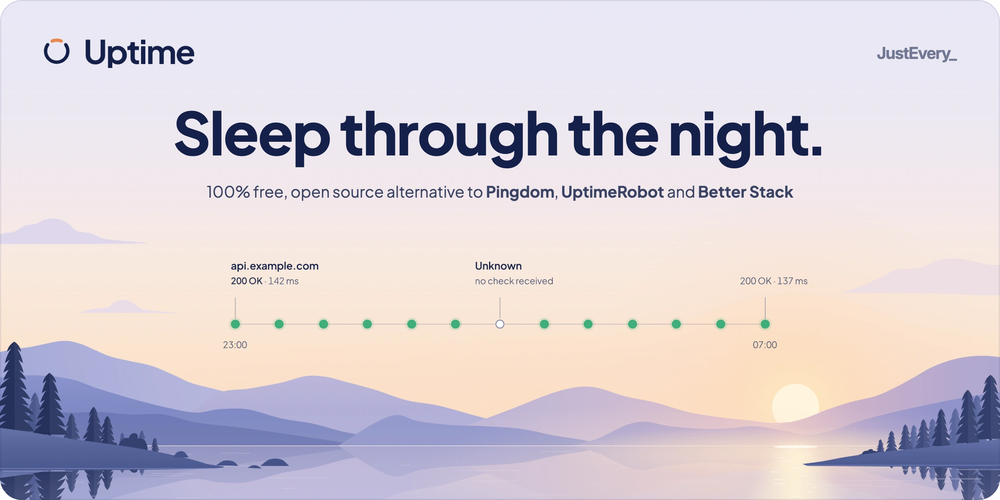
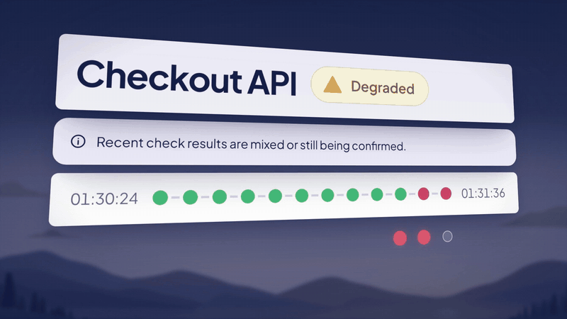
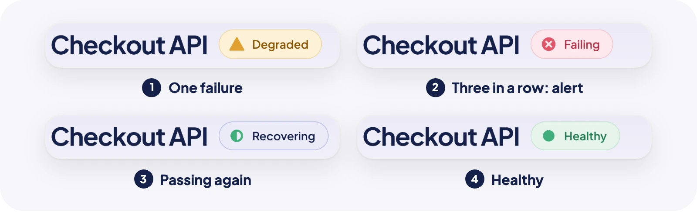
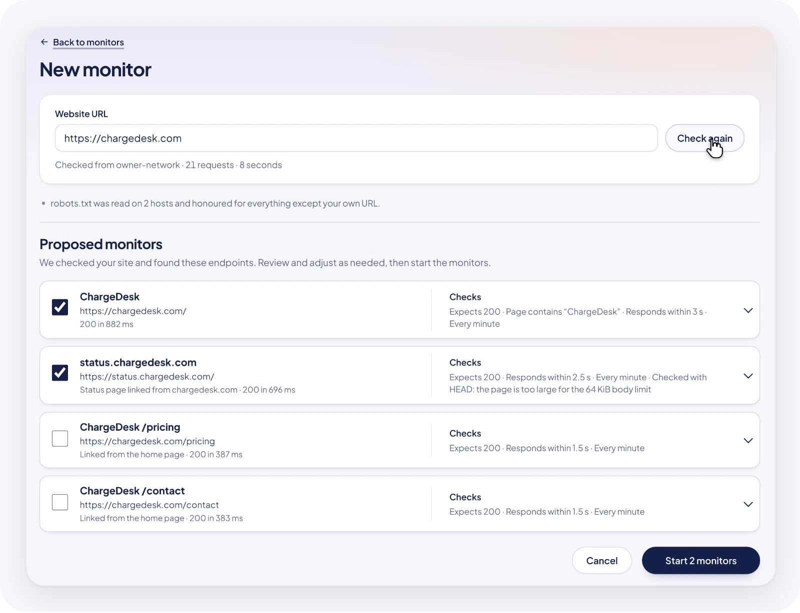
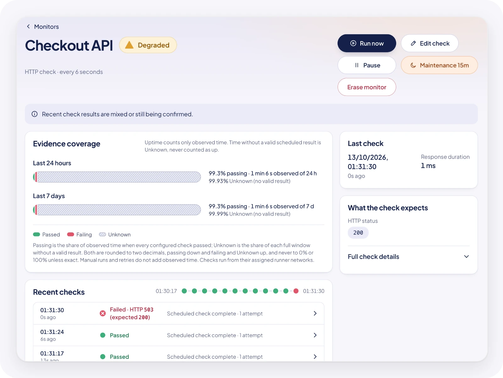

<p align="center">
  <a href="https://run-uptime.com">
    <picture>
      <source media="(prefers-color-scheme: dark)" srcset=".github/assets/banner-dark.webp">
      <source media="(prefers-color-scheme: light)" srcset=".github/assets/banner-light.webp">
      
    </picture>
  </a>
</p>

<p align="center"><a href="https://run-uptime.com">run-uptime.com</a> · <a href="https://justevery.com">Part of Just Every</a> · <a href="LICENSE">MIT licensed</a></p>

<p align="center">
  <a href="https://justevery.com/#vol-uptime"></a>
</p>
<p align="center"><a href="https://justevery.com/#vol-uptime"><b>Watch the full demo</b></a> · 51 seconds</p>

<p align="center">
  
</p>

<p align="center">
  <br>
  <sub>Start with one URL: Uptime looks around your site and proposes what to watch.</sub>
</p>

<p align="center">
  <br>
  <sub>One failed check marks a monitor Degraded; it is not an alert yet.</sub>
</p>

# Uptime

## Run it on your computer

Use Node exactly 22.20.0 and pnpm 10.12.4. Uptime is developed in its public repository, [just-every/run-uptime](https://github.com/just-every/run-uptime): candidate work on branches, accepted work on `main`, and each release is a version tag on `main`. Public v0.1.1 is the security predecessor that closed the local development file-exposure issue in v0.1.0. The latest published version is v0.1.2 at tag commit `bdcd147542e0fab55be2663f05165a0724b4e49e`; it has no GitHub Release entry. This branch is preparing v0.1.3, which remains unpublished.

```sh
git clone https://github.com/just-every/run-uptime.git uptime
cd uptime
rer install
rer setup --owner-email owner@example.test --owner-name "Local Owner" --non-interactive
```

`rer` runs each verb with the `@runeditrun/rer` version this checkout pins in `package.json`. Without `rer` on your PATH, install it once with `npx -y @runeditrun/rer cli install`.

Replace the example address with the owner's address. To start with monitors already proposed, also give setup the website to monitor in a private, mode-0600 JSON file, `answers.json` containing `{"UPTIME_START_URL":"https://example.com"}`, and add `--answers answers.json` to the command. The address must be a public HTTP(S) address. It is optional: without it, `/setup` offers the same field, and leaving it empty changes nothing. When the owner opens `/setup`, Uptime asks the owner's runner to look at that site, and finishing setup opens the console on the monitors it proposes. Nothing is created until the owner chooses it. Setup builds, migrates, prepares private settings and creates the first owner, then prints `RER_SETUP_READY` and stops its temporary processes. Repeating setup preserves the owner, data and exact private settings; conflicting owner or origin answers refuse. Setup checks its generated or saved settings before opening its temporary runtime. The Worker validates configuration before handling requests or scheduled work; app, preview, deployment and runner entry points check their own configuration before serving or starting operational work. A missing or malformed value is named without printing its value; the Worker returns 503, including at `/health`, until configuration is complete. Start the foreground application:

```sh
rer dev
```

`rer dev` opens signed in: it prints `RER_SIGNED_IN` (the owner) and `RER_OPEN`, a link that carries this checkout's private dev key in its fragment. Open `RER_OPEN` in a browser on this computer and you land signed in as the owner; a small dev badge switches to the `member` persona (a signed-in operator who is not the owner) or signs out. Never share the link: the key is what keeps the outbox and dev sign-in closed to anything that reaches this port through a proxy or tunnel, and `reset` removes the key so every earlier browser session stops working. `--as member` (or `--as signed-out`) starts as another persona, and `--login` turns dev identity off so dev prints `RER_SIGN_IN` and a key-carrying `RER_OPEN` for the outbox instead: choose the newest message and follow its one-use link (no email is sent). Uptime retains local development sign-in captures until their associated operator is erased or `rer reset --yes`; they do not expire by age or count. Previews open the outbox the same way. `RER_OPEN` is for people at this terminal; scripts use `rer dev --json` or the key header. First-run setup opens at `/setup`; choose **Finish setup** to enter the private console at `/app`. Until then, app routes return the signed-in owner there. The app origin serves its Lobby at `/` and public documentation at `/docs`; `/app` is the private operator console and `/setup` is first-run setup. The separate marketing site is `https://run-uptime.com/`, with a `/run` page: `rer build --site` writes the site to `dist/site` and `rer dev` serves it at `RER_SITE`. Vite provides assets and HMR alongside the bundled target and signed private runner. Control-C stops all owned processes. From another terminal, `rer outbox` prints the outbox URL; `outbox --owner-email owner@example.test` requests a fresh message.

Use `rer describe` for commands and flags, `rer check --profile first-party` for the read-only contract check, and `rer doctor` to compare your Node and pnpm with the pinned versions (run it under Node 22.20.0) and check that local state is safe. Doctor also lists every input the deployment needs (Cloudflare, the selected mail provider, `RER_DEPLOY_*` and the like) under `missingInputs`. On a local install these are expected to be missing until you deploy, so it reports `ok: false` and exits 3 even when the local app is healthy. Read the `node`, `pnpm` and `state` lines, not `ok`. The structural check works before dependency installation. Private settings are `data/local-secrets.json` (0600); durable data is `.wrangler/state`. There is no automatic credential rotation. See [OPERATIONS.md](OPERATIONS.md) for state custody and recovery.

## Verify

Run `rer verify` for the complete product checks. Browser prerequisites are in [OPERATIONS.md](OPERATIONS.md). Sessionless public routes and assets are declared in `seed.json` and limited by client and path class; excess requests receive 429 with `Retry-After`, and unavailable counter storage returns 503. These source limits are marked estimated and not load-tested. A local passing result establishes neither hosted operation nor recipient acceptance.

Native setup uses email-link sign-in. The optional `IDENTITY_PROVIDER` declaration does not enable linked sign-in: the completed local probe read provider metadata, then selected-provider setup failed at an unmounted dependency-approval route (404) before creating the owner. Public check, omitted-provider setup, native sign-in/session revocation and exact repeat preservation passed. Linked-provider lifecycle adoption is a separate round.

The standalone native product has no operational marketplace or author dependency. An optional owner-configured private management editor may contact the author if its configured origin belongs to the author; this is the explicit BASE-DATA-005 replacement in [CONTRACT.md](CONTRACT.md). An emitted-runtime proof with optional integrations absent and outside requests denied passed native sign-in, monitoring failure/recovery, history and export; this is local standalone evidence, not complete hosted/provider egress acceptance.

## Try the bundled local monitor

After signing in, open **Runner / Archive** and note the number shown under **Authorized local endpoint ports**. The port is selected when `rer dev` starts. In **New monitor**, enter `http://127.0.0.1:<authorized-port>/health` as the **Target URL**, leave **Request method** at `GET` and **Expected HTTP status** at `200`, and keep only **Check 1** selected under **Checks to include**. Enter `0.1` for **Check every (minutes)**; that is a six-second interval. Set **Alert after this many failed checks** and **Recover after this many passing checks** to `1`, then choose **Save monitor**.

The new scheduled check is due when you save. The private runner polls about once a second and the console refreshes every five seconds, so leave the monitor open until its first result appears. After changing the target mode below, wait for the next scheduled result; the six-second interval is followed by runner polling and the page refresh. **RUN NOW** creates a manual check and does not change scheduled health or incident thresholds.

From the repository root in a second terminal, read the current port from the local grant once. Leave `rer dev` running in its original terminal:

```sh
target_port="$(node --input-type=module -e 'import { readFileSync } from "node:fs"; process.stdout.write(String(JSON.parse(readFileSync(".wrangler/state/synthetic-grant.json", "utf8")).port));')"
```

Start in healthy mode and wait for a scheduled **Healthy** result:

```sh
curl --fail --silent --show-error --request POST "http://127.0.0.1:${target_port}/control" --header 'content-type: application/json' --data '{"mode":"healthy"}'
```

Switch the fixture to failing mode. `/health` now returns HTTP 503; the next scheduled result should be **Degraded**. This single local vantage has no independent agreement. Production failure alerting requires another network or a passing external check. A monitor on one network takes the installation's External check URL (default `https://example.com/`, changed on Runner / archive) when you save it:

```sh
curl --fail --silent --show-error --request POST "http://127.0.0.1:${target_port}/control" --header 'content-type: application/json' --data '{"mode":"failing"}'
```

Switch back to healthy mode and wait for the next scheduled result to show recovery:

```sh
curl --fail --silent --show-error --request POST "http://127.0.0.1:${target_port}/control" --header 'content-type: application/json' --data '{"mode":"healthy"}'
```

The synthetic target binds only to `127.0.0.1`. Its owner-only grant at `.wrangler/state/synthetic-grant.json` records the current process, port, allowed paths and expiry; each probe must match that grant, and the runner checks the fixture's process and response identity. `/health` is an allowed monitor path. `POST /control` is a local fixture control, not a probe target. This walkthrough demonstrates the bundled fixture only; it does not establish the health of an external service or another network vantage.

## Reset the local installation

Stop dev first, then export to a new private file under exports/ within the checkout:

```sh
rer export --output exports/uptime.rer
rer reset --yes --non-interactive
rer setup --owner-email owner@example.test --non-interactive
```

Reset lists and removes only local data, generated settings, command captures and CLI bookkeeping. It retains source, dependencies, external archives and deployment receipts. A second reset succeeds with an empty inventory. Reset refuses while dev or transfer owns the installation.

## Erase an entity

In the owner console, erase a monitor, notification destination, or operator while at least one active owner remains. Monitor erasure requires typing the current monitor name. The action returns a receipt showing the entity kind, per-table counts and completion time; the receipt is retained in later product archives. Destination erasure removes the destination, its credentials, dependent notification jobs and delivery records, replay entries, and matching archive-history copies. Operator erasure revokes that operator's sessions and sign-in material. Erasing the original owner also anonymises its bootstrap reference while keeping setup permanently claimed; the receipt counts that row as anonymised. The durable audit records destructive actions, notification send attempts (including test sends), and authentication-mail sends or local development captures. Audit entries remain with opaque subject references; when an operator is erased, its earlier actor references are anonymised. The audit is included in later product archives.

Erasing an operator does not change `OWNER_EMAIL` in saved settings or the hosted Worker binding. If it named the erased operator, a surviving owner can still sign in with their own email and export from the console. Before using local `rer` commands again, stop dev and change only `OWNER_EMAIL` in `data/local-secrets.json` to an existing surviving active owner. Preserve every generated key and all other settings, then run `rer setup --owner-email EMAIL --non-interactive` with that same email. Supplying the new email to setup without first updating the saved setting is refused. This selects an existing owner; it does not create or transfer an identity. On hosted installations, the deployment owner must update the `OWNER_EMAIL` binding separately; D1 erasure does not change provider configuration.

The last active owner cannot be erased. Use `rer reset --yes` to replace the owner of a local installation. Replace a hosted installation by redeploying and establishing a new owner. Uptime has no R2 storage or uploads, so there are no uploaded attachments to erase. Erasure cannot change archives already downloaded, recall messages already sent to external email, webhook or Slack services, or stop a request already in progress from reaching its provider. If restoring an older offline archive after erasure, first choose **Export erasure journal** in **Runner / Archive**, then supply it with the archive. Local import uses the absolute journal path: `UPTIME_LATER_JOURNAL=/absolute/path/to/uptime-erasure-journal.json rer import --input exports/older-uptime.rer --yes`. The old archive alone cannot identify erasures in a brand-new installation that has never received that journal; this is a limit of Base's offline transfer model.

## Put it on your own Cloudflare account

Supply the owner deployment inputs for `rer deploy`. Hosted sign-in requires a selected Base mail adapter (Resend, SendGrid or Cloudflare), a verified sender, and the selected provider's credentials. The review names Worker `uptime-monitor-production` and database `uptime-monitor-production-db`; Cloudflare assigns the hosted origin after deployment. It needs `CLOUDFLARE_ACCOUNT_ID`, `CLOUDFLARE_API_TOKEN`, `OWNER_EMAIL`, `MAIL_FROM`, and the selected mail credentials: `MAIL_PROVIDER=sendgrid` (the existing-install default when unset) with `SENDGRID_API_KEY`, `MAIL_PROVIDER=resend` with `MAIL_PROVIDER_API_KEY`, or `MAIL_PROVIDER=cloudflare` with `CLOUDFLARE_MAIL_API_KEY` and `MAIL_ACCOUNT_ID`. There is no automatic fallback between providers. The independent `SESSION_SECRET`, `SETUP_TOKEN`, and `UPTIME_RUNNER_KEY` are generated for a new installation or reused from the owner-only `.rer/deploy/production-secrets.json` settings file. Keep that file private and back it up separately from D1.

Run `rer deploy` to build and provision the Worker, D1 database, migrations, and Cron in your account. The command reports the hosted origin. Use `SETUP_TOKEN` from `.rer/deploy/production-secrets.json` at `/claim` once to create the hosted owner, then finish `/setup`; the owner then works in the console at `/app`. The Cloudflare account deployment path is implemented and was exercised end to end once on version 0.1.1. A deployment that stops part way names its stage and code, and the same command resumes it; `--environment NAME` deploys a separate installation, checked with `pnpm run health -- --environment NAME`. The deploy command does not run the private probe runner for you.

On infrastructure authorized to reach your targets, load `UPTIME_CONTROL_ORIGIN` with the exact hosted HTTPS origin and `UPTIME_RUNNER_KEY` from the private deployment settings, then run:

```sh
node runners/src/private-runner.mjs
```

The runner signs its enrolment before polling and reuses its independently keyed durable runner identity after restart. Keep it under a supervisor. A healthy Worker does not establish that the runner is operating. See [ACCEPTANCE.md](ACCEPTANCE.md) for hosted acceptance requirements.

## Move your data

Use `rer export --output exports/uptime.rer` after stopping dev. The new 0600 file is a Base integrity archive containing Uptime's product payload: definitions, observations, events, destination definitions, delivery and preserved archive history, erasure receipts, the permanent action audit and source erasure journal. On a new receiving checkout, first run `rer setup --owner-email owner@example.test --non-interactive` to establish its owner and private settings, then run `rer import --input exports/uptime.rer --yes` while its product data is empty. Monitors remain paused, destinations disabled and imported notifications quarantined. Installation settings, sessions, grants, runner authority, webhook and Slack URLs, and signing keys are excluded; available email addresses travel with destination definitions. Hosted CLI transfer is unsupported; the authenticated console retains its existing archive format and actions. Private settings remain a separate backup. The owner accepted this installation-authority and webhook/Slack-credential archive policy on 2026-10-13.

## Keep monitors as a reviewed file, or move from UptimeRobot

Open **Definitions** in the console to preview an `uptime.monitors.json` definition file, or saved UptimeRobot v3 `GET /monitors` pages, before anything changes. The preview lists each entry as create, unchanged, change, refused or unsupported, with every difference from the source spelled out, and ends with a plan digest. Apply writes exactly that preview or nothing: new monitors arrive paused, changes become new revisions that keep each monitor's on/off and maintenance state, and nothing enables a monitor, issues a heartbeat token, sends a notification or touches a destination. Each apply is a batch you can undo; undo never removes history. **Export current definitions** writes the same file back. With dev stopped, `node scripts/definitions.mjs preview|apply|export|batches|undo` runs the same engine locally. An UptimeRobot log export is only counted as history. See [Definition files](docs/definitions.md) and [Moving from UptimeRobot](docs/moving-from-uptimerobot.md); no real UptimeRobot export has been tested.

## Get told when a check fails

Open **Notifications** and add an email, signed JSON webhook, or Slack incoming webhook. An enabled destination applies to every monitor in that installation. Email uses the same selected Base mail adapter and sender configuration as operator sign-in. When the private runner polls, the Worker submits queued email through the selected Base mail adapter and the runner sends signed JSON and Slack requests. Keep the runner running on infrastructure authorized to reach the configured targets so queued notifications and target checks can run.

The saved email address is visible to the signed-in owner and editable in **Edit**. Private webhook and Slack URLs are never listed again. If credentials become unavailable, edit the destination and re-enter its address or URL; a signed webhook receives a new one-time secret.

Deleting a destination erases its credentials and dependent local jobs, delivery records, replay entries and archive-history copies. A network request already started by the runner may still reach its provider. Rotating a webhook secret asks for confirmation and invalidates the old secret immediately: copy the new secret from the named dialog and update your receiver. The dialog includes collapsed verification instructions; closing clears its secret from browser memory and it cannot be retrieved. Email destinations show a warning until the installation sender is configured; use **Set up email** for the next step.

Use **Run alert drill** to check that a destination reaches a person. It sends one test event marked as a drill, with a one-time link the recipient opens and confirms; opening the link alone confirms nothing. The destination then shows Submitted (Uptime started the send), Acknowledged (the provider or endpoint answered, or Uncertain/Failed with its code) and Recipient confirmed (reported by the recipient) as separate lines. It also shows **Last proven**, **Not proven in 30 days** or **Never proven**. Whether anyone acted is not measured. A confirmed drill is a recipient's report for one message at one time; it is not evidence of monitoring, of later delivery or of a human response. A new address or URL, a rotated secret or a restore resets the destination to Never proven. See [Notifications](docs/notifications.md#run-an-alert-drill).

Use **Send test** to queue a test event for one destination. It does not change monitor evidence, open an incident, or recover one. “Accepted” means the provider or endpoint acknowledged the request; it does not prove that a person read it or was paged. A `500`, timeout, lost connection, or unknown response is uncertain and is never sent again automatically. Inspect the receiver before taking any manual action.

For Lamp's native alert intake, create an HMAC-SHA256 alert source in **Alerts** and use the endpoint Lamp displays. Set its timestamp header to `x-lamp-timestamp`, signature header to `x-lamp-signature`, deduplication path to `$.incidentKey`, title path to `$.title`, state path to `$.state`, and recovered value to `recovered`. These are top-level fields in Uptime's signed JSON event. Use the one-time signing secret shown when the destination is created as literal UTF-8 bytes; do not hex-decode it. Uptime sends an ISO 8601 UTC timestamp ending in `.000Z` and an unprefixed, unpadded base64url HMAC-SHA256 over the exact UTF-8 timestamp, a dot, and the exact body; Lamp checks the timestamp within five minutes. Uptime also sends Base `webhook-*` headers for Base-compatible receivers, but Lamp's native intake source authenticates with the configured `x-lamp-*` pair. A test event has `incidentKey: null` and `state: "test"`, so it is not a valid Lamp incident intake; use it to check a generic receiver, then verify Lamp with an authorized firing/recovery event.

Email, signed JSON, and Slack routing is installation-wide. Uptime does not provide per-monitor destination filters, Teams or Discord delivery, SMS, on-call paging, incident escalation, or public status communication. One runner is one network vantage, even when monitor names suggest different locations.

## Monitoring behavior

Uptime stores immutable scheduled evidence for HTTP(S), keyword, incoming heartbeat and browser-flow monitors. A scheduled check never starts sooner than one interval after the monitor's previous scheduled check started, by the Worker's own clock. Missing or expired evidence is **Unknown**. A successful past response does not promise current availability. Manual checks do not confirm or recover incidents. Public HTTP(S) connections validate every DNS answer and redirect hop and pin the socket while retaining the original Host and TLS identity. Request secrets stay in protected runner-local files.

HTTP monitors support status, body text, header, JSON, and latency assertions. Keyword monitors require a body text assertion. Heartbeats use owner-issued, revision-scoped tokens and increasing sequences; receipt ingestion alone cannot change target health. A bounded browser flow is also supported, on a runner with a browser, and is defined in a definitions file or through the monitor API (see [docs/monitors.md](docs/monitors.md)). DNS, ping, TCP and domain-expiry checks are not implemented.

Restores require empty product data. A local CLI restore requires setup on the receiving checkout first, so its owner and private settings are in place before import. Imported definitions are paused, leases interrupted, destinations disabled, and alerts quarantined. Destination type, name, enabled setting, and available email address travel with delivery history for destinations that remain in the source data; webhook and Slack URLs, signing keys, and credentials remain with the installation. Re-enter webhook and Slack URLs, plus any email address unavailable in the archive, then deliberately enable destinations and resume monitoring before execution. Imported incidents never send notifications. Archive hashes check integrity, not trustworthy provenance.

Observation metadata has no automatic age or count deletion. Expired sessions and rate-limit/auth-attempt counters are cleaned up; expired discovery work is marked expired and retained. Drill history remains after its one-time link material is cleared, retired destination credentials are scrubbed after owner rotation or deletion once sends finish, and a proven-unsent delivery attempt reservation may be removed while its delivery history stays. Entity erasure is a separate, explicit operator action. Target response bodies and probe-request secrets are not retained in observations; notification destination credentials remain installation-local and are omitted from portable archives. View, monitor, and archive bounds are not a storage retention policy or measured capacity claim. Network isolation, independent runner placement, operator acceptance, accessibility, hosted operation, and notification recipient acceptance each need their own evidence.

Before browser verification, install the browser matching pinned Playwright 1.60.0 with `pnpm exec playwright install --only-shell chromium` under Node 22.20.0. See [OPERATIONS.md](OPERATIONS.md) for Linux CI and shared-cache prerequisites.

See [CONTRACT.md](CONTRACT.md) for guarantees, [BASELINE.md](BASELINE.md) for shared baseline evidence, [ACCEPTANCE.md](ACCEPTANCE.md) for validation requirements, [OPERATIONS.md](OPERATIONS.md) for setup and delivery operations. `rer verify` runs local build, type, and runtime checks; those checks alone do not establish hosted operation or recipient acceptance.

## Upgrading

An upgrade keeps your data: `rer setup` on the same checkout applies the new additive migrations (earlier tables are never rewritten, the migration history only gains rows) and preserves the owner and existing private values; the v0.1.3 candidate adds only the optional `IDENTITY_PROVIDER` setting. Nothing is sent while setup runs. If an upgrade is interrupted (a closed terminal, a crash or a power loss), run the same `rer setup` again: each migration commits together with its history row, so the rerun applies only the missing ones and every earlier row is kept. Local browser sessions from 0.1.2 sign in again once after the upgrade, because local session cookies are now named per port. Archives from 0.1.2 or earlier must be re-exported from the upgraded installation first: `rer import` refuses them with a plain message and exit code 4, and writes nothing.

## Source and licence

Original implementation and original interface assets are licensed under [MIT](LICENSE). No competitor screenshots, captures, or proprietary assets are included. Base provenance is retained in the declared source metadata. [HANDOVER.md](HANDOVER.md) maps the maintained components.

Notification credentials are encrypted in D1 using a purpose-separated key
from the installation's existing `SESSION_SECRET`. Preserve that secret across
upgrades and restarts. Notification setup completes the key-bearing upgrade
before using stored credentials. An unavailable credential stops only its
destination from sending; monitoring and sign-in remain available. After a
session-secret rotation, sign in again and edit unavailable destinations to
re-enter their credentials. Webhook rotation cancels queued work for the old
credential. Once no send is in progress, its endpoint, signing key and ciphertext
are scrubbed and `retired_at` is set; an in-progress send keeps its credential
until its outcome is recorded. Destination erasure removes every credential
version and its dependent local delivery history. Slack uses only its private
incoming-webhook URL and has no Uptime signing secret. See the notification
custody and upgrade procedure in [OPERATIONS.md](OPERATIONS.md).

Assisted delivery artifacts and the owner editor are described in
[`scripts/delivery/README.md`](scripts/delivery/README.md). Packaging is local;
stage installation and publishing stay with the owner.

## Independent watches and runner vantages

Public v0.1.2 uses per-runner keys, immutable probe assignments, stored-evidence state and independent-vantage failure agreement. Mail is selected through Base adapters. See [the monitoring setup and C3/C4 rules](docs/resilient-monitoring.md). Public v0.1.1 does not include these.
