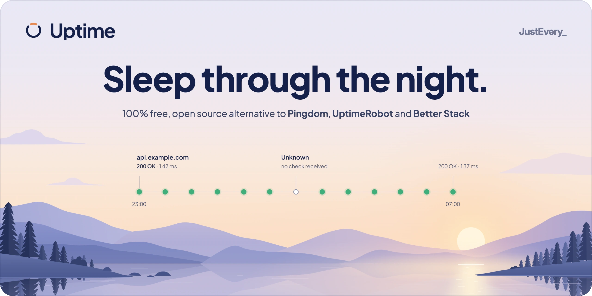
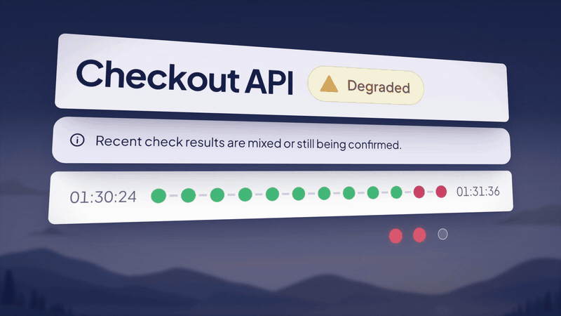
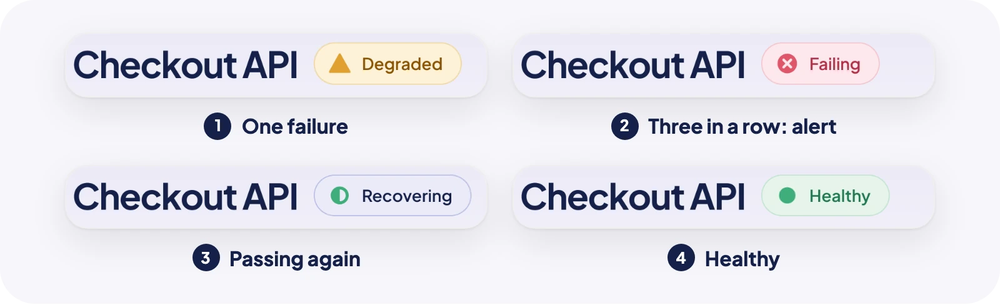
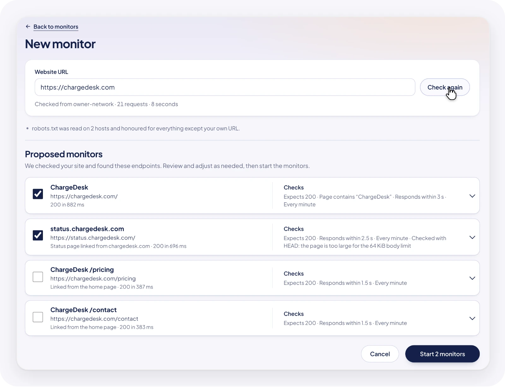
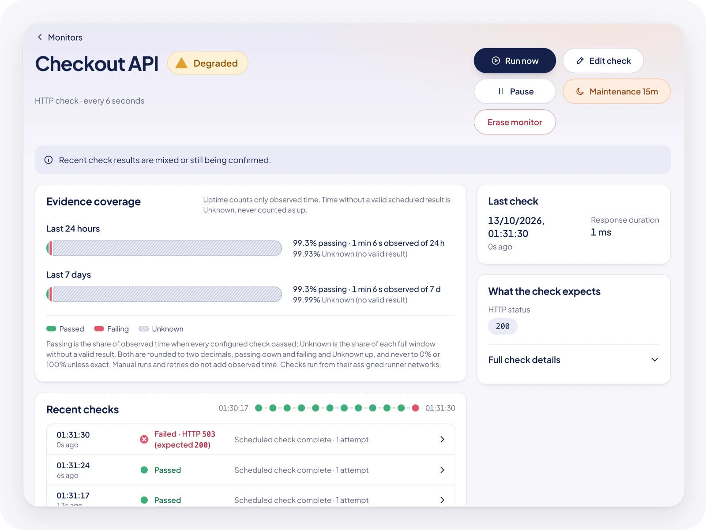

<p align="center">
  <a href="https://run-uptime.com">
    <picture>
      <source media="(prefers-color-scheme: dark)" srcset=".github/assets/banner-dark.webp">
      <source media="(prefers-color-scheme: light)" srcset=".github/assets/banner-light.webp">
      
    </picture>
  </a>
</p>

Uptime checks your site and tells you when it’s down. It does not publish a page for your customers.

<p align="center"><a href="https://run-uptime.com">run-uptime.com</a> · <a href="https://justevery.com">Part of Just Every</a> · <a href="LICENSE">MIT licensed</a></p>

<p align="center">
  <a href="https://justevery.com/#vol-uptime"></a>
</p>
<p align="center"><a href="https://justevery.com/#vol-uptime"><b>Watch the full demo</b></a> · 49 seconds</p>

<p align="center">
  
</p>

<p align="center">
  <br>
  <sub>Start with one URL: Uptime looks around your site and proposes what to watch.</sub>
</p>

<p align="center">
  <br>
  <sub>One failed check marks a monitor Degraded; it is not an alert yet.</sub>
</p>

# Uptime


## Run it on your computer

Use Git on macOS, Linux or Windows with WSL2. The CLI selects the checkout's pinned Node 22.20.0 for application commands; direct `node` and `pnpm` contributor commands use that pinned runtime. Uptime is developed in its public repository, [just-every/run-uptime](https://github.com/just-every/run-uptime). Find the current published version under [GitHub Releases](https://github.com/just-every/run-uptime/releases/latest). Each release is a version tag on `main`. See [the release record](RELEASE.json) for this checkout's version, [the changelog](CHANGELOG.md) for changes and [the release procedure](RELEASE.md) for producing the annotated tag and bundle.

```sh
curl -fsSL https://runeditrun.com/install.sh | sh -s -- dev just-every/run-uptime
```

That one line installs `rer`, clones Uptime and starts it; Node does not need to be installed first. The same in two steps: run `curl -fsSL https://runeditrun.com/install.sh | sh`, then `~/.local/bin/rer dev just-every/run-uptime`.

Already have Node 22 or later? This alternative does the same:

```sh
npx -y @runeditrun/rer cli install
~/.local/bin/rer dev just-every/run-uptime
```
If you see `rer: command not found`, run `~/.local/bin/rer cli path` and paste the line it prints.

To start it again later, run `cd run-uptime && ~/.local/bin/rer dev`. To choose the owner yourself, install `rer` with `curl -fsSL https://runeditrun.com/install.sh | sh`, then run `~/.local/bin/rer install just-every/run-uptime`, then these from the checkout instead:

```sh
~/.local/bin/rer setup
```

```sh
~/.local/bin/rer dev
```

`rer` runs each verb with the `@runeditrun/rer` version this checkout pins in [`package.json`](package.json). The installer keeps Node private to `rer`, so `node` may not be on your PATH: wherever this README or the docs show `node scripts/NAME.mjs ARGS`, run `~/.local/bin/rer run --script scripts/NAME.mjs ARGS` instead.

`~/.local/bin/rer install` installs the frozen dependencies. `~/.local/bin/rer setup` creates the first owner and private local settings; follow its prompts. A checkout already set up keeps its existing owner and data. `~/.local/bin/rer dev` starts the app, private runner and practice target. In an interactive terminal it stays in the foreground; Control-C stops it. From a non-interactive shell it returns once ready and leaves the app running. Use `~/.local/bin/rer dev --detach` for an explicit background run. A first local start usually takes about a minute. On a busy computer it can take longer: `rer dev` prints progress every 20 seconds, with the limit to allow. Repeating `~/.local/bin/rer dev` resumes an interrupted setup.

Open the private link printed as `RER_OPEN` by `~/.local/bin/rer dev` on this computer to sign in. Keep the link private. The plain `RER_READY` address opens the public Lobby. First-run setup opens at `/setup`; enter **Your name** and **Your email**, give the installation a name under **What should we call this?**, then choose **Continue** to enter the console at `/app`. You can change the installation name later in **Settings › General** and your own name or email under **Settings › People › Change**. Until then, app routes return the owner to `/setup`. Hosted email-link sign-in and notifications use your configured mail sender. Development and demo runs report successful sends without sending email. See [Install](docs/getting-started.md) for setup details.

The app origin serves its Lobby at `/` and documentation at `/docs`. The separate marketing site is `https://run-uptime.com/`, with a `/run` page: `~/.local/bin/rer build --site` writes it to `dist/site`, and `~/.local/bin/rer dev` serves it at `RER_SITE`. Vite provides assets and HMR. Stop the app and its owned runner and practice target with `~/.local/bin/rer dev --stop`, including before deployment, export, import or reset.

Use `~/.local/bin/rer describe` for commands and flags, `~/.local/bin/rer check --profile first-party` for the read-only contract check, and `~/.local/bin/rer doctor` to compare your Node and pnpm with the pinned versions (run it under Node 22.20.0) and check that local state is safe. Doctor also lists the inputs a deployment needs (Cloudflare, the selected mail provider and the like) as “Optional for local use; needed to deploy”. These deployment inputs are optional for local use. If doctor reports “Local checks need attention” and exits 3, read the named local checks and correct them before continuing. The structural check works before dependency installation. Private settings are `data/local-secrets.json` (0600); durable data is `.wrangler/state`. There is no automatic credential rotation. See [OPERATIONS.md](OPERATIONS.md) for state custody and recovery.

## Supply owner setup answers

For a non-interactive setup, supply the owner explicitly. A checkout already set up preserves its existing owner.

After installing `rer` and cloning with `~/.local/bin/rer install just-every/run-uptime`, use, from the checkout:

```sh
~/.local/bin/rer setup --owner-email owner@example.test --owner-name "Local Owner" --non-interactive
```

Replace the example address with the owner's address. To start with monitors already proposed, also give setup the website to monitor in a private, mode-0600 JSON file, `answers.json` containing `{"UPTIME_START_URL":"https://example.com"}`, and add `--answers answers.json` to the command. The address must be a public HTTP(S) address. It is optional: without it, `/setup` offers the same field, and leaving it empty changes nothing. When the owner opens `/setup`, Uptime asks the owner's runner to look at that site, and finishing setup opens the console on the monitors it proposes. Nothing is created until the owner chooses it. Setup builds, migrates, prepares private settings and creates the first owner, then prints `RER_SETUP_READY` and stops its temporary processes. Repeating setup preserves the owner, data and exact private settings; conflicting owner or origin answers refuse. Setup checks its generated or saved settings before opening its temporary runtime. The Worker validates configuration before handling requests or scheduled work; app, preview, deployment and runner entry points check their own configuration before serving or starting operational work. A missing or malformed required value is named without printing its value; the Worker returns 503, including at `/health`, until configuration is complete. `SETUP_TOKEN` is required until permanent owner admission is recorded; after admission, retiring it does not interrupt sign-in, routes or scheduled work, even before `/setup` is finished. Then start the app with `~/.local/bin/rer dev`.

### Set up Uptime for a company

Set Uptime up first, before the tools it will watch: it needs none of them. Wait for the owner's real email before running setup (`--owner-email`; a hosted deploy needs the same address as `OWNER_EMAIL`): setup refuses a different owner address afterwards instead of replacing it. Once it is set up, give it the company's old monitor targets. Use the company's public website as `UPTIME_START_URL`, **New monitor › Paste many URLs or a CSV**, or a file from the old service under **Settings › Backup and files**: an `uptime.monitors.json` definition file, or saved UptimeRobot, Pingdom, Better Stack or Site24x7 responses (imported monitors arrive paused until someone starts them).

Its first check after a new install: a monitor on the company's own domain reads **Healthy** once its first scheduled check passes; until a scheduled result arrives it reads Unknown. The console's state words are Healthy, Degraded, Failing and Unknown, and Healthy needs a passing check, never a missing one. A hosted installation cannot watch its own address from the Worker, but the company's domain is not that address. For the hosted Cron schedule, see [Pick the Cron schedule](#pick-the-cron-schedule).

## Verify

Run `~/.local/bin/rer verify` for the complete product checks. Push and pull-request CI run parallel shards; installer and README clone journeys run nightly and on version tags. The aggregate Verify job requires every selected shard. Browser prerequisites are in [OPERATIONS.md](OPERATIONS.md). Sessionless public routes and assets are declared in `seed.json` and limited by client and path class; excess requests receive 429 with `Retry-After`, and unavailable counter storage returns 503. These source limits are marked estimated and not load-tested. A local passing result establishes neither hosted operation nor recipient acceptance.

Native setup uses email-link sign-in. The optional `IDENTITY_PROVIDER` declaration does not enable linked sign-in: the completed local probe read provider metadata, then selected-provider setup failed at an unmounted dependency-approval route (404) before creating the owner. Public check, omitted-provider setup, native sign-in/session revocation and exact repeat preservation passed. Linked-provider lifecycle adoption is a separate round.

The standalone native product has no operational marketplace or author dependency. An optional owner-configured private management editor may contact the author if its configured origin belongs to the author; this is the explicit BASE-DATA-005 replacement in [CONTRACT.md](CONTRACT.md). An emitted-runtime proof with optional integrations absent and outside requests denied passed native sign-in, monitoring failure/recovery, history and export; this is local standalone evidence, not complete hosted/provider egress acceptance.

## Try the bundled local monitor

Keep `~/.local/bin/rer dev` running. From the repository root in a second terminal, first check the CLI path and available commands, then read the practice target's address and print its health URL:

```sh
~/.local/bin/rer cli path
~/.local/bin/rer describe
if target_output="$(~/.local/bin/rer run practice-target)" &&
   target_url="$(printf '%s\n' "$target_output" |
     awk '/^http:\/\/127[.]0[.]0[.]1:[0-9]+$/ { url=$0; count++ } END { if (count == 1) print url; else exit 1 }')"; then
  printf '%s/health\n' "$target_url"
else
  unset target_url
  printf '%s\n' 'Practice target unavailable. Keep Uptime running and repeat this step.' >&2
fi
```

`describe` lists the available commands; the practice-target helper reads the running target’s address. The block prints a health URL only after that helper succeeds and returns one complete local address. `rer` uses its managed runtime, so you do not need `node` on your PATH. Copy the printed health URL, including its selected port; it can change when you start a new installation. Before saving the monitor, set **External check URL** in **Settings › General** to a public site you do not run. **New monitor** first asks for a website address so it can suggest checks; choose **Fill in the form yourself** to open the full form. There, name the monitor **Local practice**, enter the copied health URL as the **Target URL**, leave **Request method** (under **Advanced**) at `GET` and **Status** at `200` under **Up when**, and keep only the local location ticked under **Check from**. It is named after a city (or the name you gave it); check **Locations** if you need to identify it, and leave the hosted location unticked. Enter `0.1` for **Check every (minutes)**; that is a six-second interval. Set **Failed checks in a row** and **Back up after passing checks** to `1`, then choose **Save monitor**.

If you add an untagged monitor to check a read key’s scope, give it a target on a different site from your **External check URL**. For example, with `https://example.com/` as the external check, use `https://www.iana.org/` for **Independent baseline**.

The new scheduled check is due when you save. The private runner polls about once a second and the console refreshes every five seconds, so leave the monitor open until its first result appears. After changing the target mode below, wait for the next scheduled result; the six-second interval is followed by runner polling and the page refresh. **RUN NOW** creates a manual check and does not change scheduled health or incident thresholds.

Keep the app running and use the same second terminal for the commands below, so `target_url` remains set to that address.

Start in healthy mode and wait for a scheduled **Healthy** result:

```sh
curl --fail --silent --show-error --request POST "${target_url}/control" --header 'content-type: application/json' --data '{"mode":"healthy"}'
```

Switch the fixture to failing mode. `/health` now returns HTTP 503; the next completed scheduled check should make the monitor **Failing** and open an incident. Keep the installation's **External check URL** (in **Settings › General**) reachable. This independent check must pass in the same slot to confirm failure from one network; if it fails, the target failure stays **Degraded**, and missing evidence is **Unknown**. Monitors use the URL in Settings from their next check:

```sh
curl --fail --silent --show-error --request POST "${target_url}/control" --header 'content-type: application/json' --data '{"mode":"failing"}'
```

Switch back to healthy mode and wait for the next completed scheduled result to show **Healthy** and close the incident:

```sh
curl --fail --silent --show-error --request POST "${target_url}/control" --header 'content-type: application/json' --data '{"mode":"healthy"}'
```

The synthetic target binds only to `127.0.0.1`. Its owner-only grant at `.wrangler/state/synthetic-grant.json` records the current process, port, allowed paths and expiry; each probe must match that grant, and the runner checks the fixture's process and response identity. `/health` is an allowed monitor path. `POST /control` is a local fixture control, not a probe target. This walkthrough demonstrates the bundled fixture only; it does not establish the health of an external service or another network vantage.

Local archive export and import require `UPTIME_ACCESS_COOKIE` holding a live native Base session cookie with second-factor verification from the previous five minutes. Obtain a native session with `~/.local/bin/rer run --script scripts/mfa.mjs local-session --origin APP_ORIGIN` and verify before stopping dev, keep the cookie in your private terminal environment, and then run the transfer. A receiving installation needs its own freshly verified owner. Enroll a second factor under **Settings › People**; each later sign-in asks for it before the console opens. See [Second factors](docs/mfa.md) for the console steps and the API/CLI alternative.

## Reset the local installation

Reset removes your monitors and history, so back them up first. The simplest backup is in the console while dev is running: open **Settings › Backup and files** and choose **Download backup** (it asks for a second factor first; enrol one under **Settings › People › Manage second factors** if you have none). Check that the downloaded backup exists and opens as JSON containing your monitors before continuing. Then stop dev and reset:

```sh
~/.local/bin/rer dev --stop
~/.local/bin/rer reset --yes --non-interactive
~/.local/bin/rer setup --owner-email owner@example.test --non-interactive
```

To back up from the command line instead, follow the `UPTIME_ACCESS_COOKIE` steps above and join the commands with `&&`, so a refused export stops before anything is removed. A bare `~/.local/bin/rer export` with no cookie is always refused (`session_required`), and in a pasted block the lines after it would still run:

```sh
~/.local/bin/rer dev --stop && ~/.local/bin/rer export --output exports/uptime.rer && test -s exports/uptime.rer
```

Use the [backup readback commands](docs/data.md#check-your-backup) to list your monitor names from the CLI `.rer` archive or the console backup. To get the console backup, choose **Settings › Backup and files › Download backup** before stopping dev. This also works in the hosted console. Check that your monitors are present before running `~/.local/bin/rer reset --yes --non-interactive`, then `~/.local/bin/rer setup --owner-email owner@example.test --non-interactive`.

Reset lists and removes only local data, generated settings, command captures and CLI bookkeeping. It retains source, dependencies, external archives and deployment receipts. A second reset succeeds with an empty inventory. Reset refuses while dev or transfer owns the installation.

## Erase an entity

In the owner console, erase a monitor, notification destination, or operator while at least one active owner remains. Monitor erasure requires typing the current monitor name. The action returns a receipt showing the entity kind, per-table counts and completion time; the receipt is retained in later product archives. Destination erasure removes the destination, its credentials, dependent notification jobs and delivery records, replay entries, and matching archive-history copies. Operator erasure revokes that operator's sessions and sign-in material. Erasing the original owner also anonymises its bootstrap reference while keeping setup permanently claimed; the receipt counts that row as anonymised. The durable audit records destructive actions, notification send attempts (including test sends), and authentication-mail sends and legacy development capture history. Audit entries remain with opaque subject references; when an operator is erased, its earlier actor references are anonymised. The audit is included in later product archives.

Erasing an operator does not change `OWNER_EMAIL` in saved settings or the hosted Worker binding. If it named the erased operator, a surviving owner can still sign in with their own email and export from the console. Before using local `rer` commands again, stop dev and change only `OWNER_EMAIL` in `data/local-secrets.json` to an existing surviving active owner. Preserve every generated key and all other settings, then run `~/.local/bin/rer setup --owner-email EMAIL --non-interactive` with that same email. Supplying the new email to setup without first updating the saved setting is refused. This selects an existing owner; it does not create or transfer an identity. On hosted installations, the deployment owner must update the `OWNER_EMAIL` binding separately; D1 erasure does not change provider configuration.

The last active owner cannot be erased. Use `~/.local/bin/rer reset --yes` to replace the owner of a local installation. Replace a hosted installation by redeploying and establishing a new owner. Uptime has no R2 storage or uploads, so there are no uploaded attachments to erase. Erasure cannot change archives already downloaded, recall messages already sent to external email, webhook or Slack services, or stop a request already in progress from reaching its provider. If restoring an older offline archive after erasure, first choose **Export erasure journal** in **Archive**, then supply it with the archive. Local import uses the absolute journal path: `UPTIME_LATER_JOURNAL=/absolute/path/to/uptime-erasure-journal.json ~/.local/bin/rer import --input exports/older-uptime.rer --yes`. The old archive alone cannot identify erasures in a brand-new installation that has never received that journal; this is a limit of Base's offline transfer model.

## Managed hosting mail

Managed hosting sends sign-in links and email notifications through the RER mail relay. You do not need a mail-provider account or an API key to type. Configure fills and hides `MAIL_PROVIDER=rer`, `MAIL_FROM`, `MAIL_RELAY_URL` and the private `MAIL_API_KEY`; RER supplies an installation- and environment-scoped relay credential, and the upstream provider key stays with RER. Assisted and Free hosting keep the existing SendGrid, Resend and Cloudflare Email Sending options and their provider credentials.

## Put it on your own Cloudflare account

Stop dev with `~/.local/bin/rer dev --stop` or preview with `~/.local/bin/rer preview --stop` before deployment, including a dry run. Supply the owner deployment inputs for `~/.local/bin/rer deploy`. Ordinary email-link sign-in and email notifications need a selected Base mail adapter (Resend, SendGrid or Cloudflare), a verified sender, and the selected provider's credentials. Enabled email requires these inputs. To deliberately run without outbound email, select `MAIL_PROVIDER=none`, omit the sender and sending credentials, and use guarded `~/.local/bin/rer signin` from the deploying checkout with its deployment receipt and deploying account credentials (Run Edit Run fleet, 2026-11-15). The review names Worker `uptime-monitor-production` and database `uptime-monitor-production-db`; Cloudflare assigns the hosted origin after deployment. Deployment needs `CLOUDFLARE_ACCOUNT_ID`, `CLOUDFLARE_API_TOKEN`, `OWNER_EMAIL` and your owner name. Supply the name with `--owner-name` on a fresh checkout unless setup already saved it. With no saved or supplied `MAIL_PROVIDER`, the default is `none`. For email, set `MAIL_FROM` and select `MAIL_PROVIDER=sendgrid` with `SENDGRID_API_KEY`, `MAIL_PROVIDER=resend` with `MAIL_PROVIDER_API_KEY`, or `MAIL_PROVIDER=cloudflare` with `CLOUDFLARE_MAIL_API_KEY` and `MAIL_ACCOUNT_ID`. If your legacy deployment has a SendGrid key and no selector, set `MAIL_PROVIDER=sendgrid` explicitly before updating. There is no automatic fallback between providers. The independent `SESSION_SECRET`, `SETUP_TOKEN`, and `UPTIME_RUNNER_KEY` are generated for a new installation; later deployments reuse saved session and runner keys, while the one-use setup token is retired after owner claim. Each environment's sole kept settings file is the owner-only `.rer/deploy/<environment>.secrets.env` (production: `.rer/deploy/production.secrets.env`), with mode 0600. Keep it private and back it up separately from D1.

The next deploy automatically migrates legacy `.rer/deploy/production-secrets.json` and `.rer/deploy/environments/<environment>/secrets.json` settings, preserving saved owner and mail inputs and every environment's keys without regenerating production keys. The installation's own `SESSION_SECRET`, `SETUP_TOKEN` and `UPTIME_RUNNER_KEY` from the legacy files replace any unused copies rer generated beside them, because those are the keys the installation was deployed with; the deploy names the keys it kept, never their values. Any other differing value already kept by rer stops deployment with the key name and file paths, never values. Legacy files remain until the move is verified, then are removed and never read or recreated; fresh installs use only the environment settings files. No manual conversion or rotation is needed. See [the upgrade guidance](docs/deploy.md#update-an-existing-deployment).

Run `~/.local/bin/rer deploy --owner-name "Your name"` to build and provision the Worker, D1 database, migrations, and Cron in your account. With rer's custom-deployment lifecycle, `~/.local/bin/rer deploy` wraps Uptime's deployment hook, claims the owner automatically, and retires the one-use hosted `SETUP_TOKEN` after admission. Inspect the command's `claimed` or `kept` owner outcome and token-retirement result, then open the reported hosted origin at `/login` for ordinary email-link sign-in and finish `/setup`; the owner then works in `/app`. The pinned CLI includes automatic owner claim, token retirement and hosted owner sign-in recovery.

If automatic claim or retirement is incomplete, keep the ownership record, rerun the same `~/.local/bin/rer deploy` command with the same environment, and inspect the reported outcome. Never use a retired token at `/claim`. See the [deployment guide](docs/deploy.md#owner-claim-and-sign-in) for the lifecycle boundary and recovery steps. The Cloudflare account deployment path was exercised end to end once on version 0.1.1; that historical run does not prove the newer lifecycle. `--environment NAME` selects a separate installation, checked with `node scripts/deployment/owner-cli.mjs health --environment NAME` from this checkout under Node 22.20.0. The deploy command does not run the private probe runner for you. `~/.local/bin/rer deploy --owner-name "Your name" --dry-run` builds and prints its resource plan without provider requests. Supply any inputs it reports as missing before deploying. Cloudflare assigns the hosted origin during a real deploy.

### Hosted sign-in

Open `/login` on your hosted app, request a link for an allowed operator email, open the email and choose **Confirm**. With explicit mail off, use guarded `~/.local/bin/rer signin` from the deploying checkout; email links and invitations are unavailable. If an enabled provider is unavailable, restore its configured sender and check the owner's address before requesting a new link. Preserve the existing deployment records and settings when repairing mail configuration; see [Deploy to Cloudflare](docs/deploy.md).

### Public checks and private runners

Public website checks and notifications run automatically in the hosted Cloudflare Worker; you do not need a private runner for them. While the owner console is open, its requests prompt due checks and sends. The one-minute Cron schedule continues background work after activation; Cloudflare can take up to about two hours to activate it on a new deployment. Use a private runner for heartbeats, website discovery, private targets and checks that need runner-local credentials or a browser. Open **Locations** and choose **Add location**. Copy the command it shows and run it on a machine on that network with Node 22.13 or later; it needs no Uptime checkout, and its one-time join key works once (on the computer running `~/.local/bin/rer dev`, the panel shows the command with `~/.local/bin/rer run --script`, which needs no Node install). A location that has not joined yet shows **Show join command** for a new key. Wait for the location to join, then choose **Done**; it is named after where it runs, and **Rename** changes that. For the original deployment runner, set `UPTIME_CONTROL_ORIGIN` to the exact hosted HTTPS origin and run `node scripts/runner-start.mjs --environment production`; replace `production` with your environment.

To monitor this Uptime installation's own address, assign a private runner. Cloudflare does not route the Worker's fetch of its own origin back to the app, so saving an active self-monitor with a Worker assignment is refused. An internal handler call would not test public routing, TLS or network reachability. Existing self-monitor assignments and redirects back to the app produce runner errors and Unknown coverage; their earlier history stays intact. The same restriction applies to a Worker's external check URL.

Keep a private runner under a supervisor. A healthy Worker does not establish that a separately operated runner is working: check its contact and actual results. See [the runner guide](docs/runner.md) and [ACCEPTANCE.md](ACCEPTANCE.md) for hosted acceptance requirements.

### Pick the Cron schedule

`rer deploy` creates one Cron trigger, `* * * * *` (every minute), and Uptime has no setting for another schedule: a different one is set on the Worker's Cron trigger in Cloudflare after deployment, and read back there. The schedule is the company manager's choice. This is what a run costs, so the choice can be made on numbers.

Each run takes at most one scheduled check per due monitor. For four healthy public HTTP monitors at one minute, the current Worker's populated local D1 fixture measured about 190 rows read and 34 written per minute, with all four checks running every minute. Individual runs in the ten-minute cadence test read 162–250 rows.

Cloudflare's 0.5.29 measurements for four healthy one-minute monitors were about 258 rows read per minute with Cron alone and 782 with one Monitors list tab open, including Cron. A window with an outage and recovery averaged 1,076 with the list tab open. The 586 figure in the 0.5.29 release notes was for one **monitor detail** tab including Cron. These hosted measurements predate the cadence fix.

The remaining rows below are from the 0.5.27 local budget fixture. All figures assume one Cron invocation per minute, without retries or an external check.

| Monitors and interval | Rows read per run | Rows written per run | Rows read per day | Rows written per day |
| --- | --- | --- | --- | --- |
| 4 every 1 minute (current fixture) | 189 | 34 | 272,500 | 48,700 |
| 4 every 5 minutes | 77 | 6.5 | 111,000 | 9,400 |
| 10 every 5 minutes | 137 | 16 | 197,000 | 23,600 |
| 20 every 5 minutes | 235 | 33 | 338,000 | 46,900 |
| 10 every 1 minute | 417 | 83 | 600,000 | 119,500 |

Failing checks, incidents and notifications add work. The tighter limit on Workers Free is its published allowance of 100,000 D1 rows written per day. Prometheus scraping every 15 seconds adds about 11,500 rows written per day. Ten one-minute monitors alone exceed the free daily write allowance.

Recommendation: keep the one-minute Cron and set the monitors' own **Check every (minutes)**. A day then takes about 8 rows written for each check taken, so aim for no more than about 6,000 checks a day (60,000 rows written) to leave headroom: four monitors every minute, or twenty every five minutes. A slower Cron saves nothing a longer interval does not: each run still takes one check per due monitor, so a five-minute Cron checks a one-minute monitor every five minutes, delays alerts and recovery by up to five minutes, and has only the 35 outbound requests of its run (about seven healthy checks at the defaults, see [Limits](docs/limits.md)) for every monitor due at once.

### Update or remove a hosted installation

Keep the existing deployment checkout clean, preserve `.rer/deploy` ownership records and private settings, and obtain newer public source with `git pull --ff-only origin main` while on `main`, or check out a reviewed commit from the public repository. Run `~/.local/bin/rer install` if the new source changes dependencies, then `~/.local/bin/rer deploy --environment NAME` again for the same environment. Inspect the recorded Worker and D1 IDs before and after: an update must retain the same resources, owner, monitors, history, destinations and saved private settings. Check health and its deployed-source identity against the reviewed public commit, ordinary `/login` sign-in, and `/setup` if unfinished or `/app` with existing data if completed. Check the separately supervised runner and its contact/results independently. See [the hosted update procedure](docs/deploy.md#update-an-existing-deployment).

To remove an installation, first export the hosted product archive from the owner console, [export D1 as SQL](docs/deploy.md#remove-a-deployment), and keep private settings separately. Then run `~/.local/bin/rer deploy --environment NAME --remove --yes`. D1 removal permanently destroys that installation's data. The command checks recorded ownership before deletion and reads back resource absence; inspect its result. If ownership cannot be established or removal is incomplete, keep the records and use manual provider inspection for recovery. See [removal](docs/deploy.md#remove-a-deployment).

## Move your data

The easiest way to take your data with you is **Settings › Backup and files › Download backup** in the console, which asks for a fresh second factor first. From the command line, use `~/.local/bin/rer export --output exports/uptime.rer` after stopping dev, with the `UPTIME_ACCESS_COOKIE` set as described above (without it, export is refused and writes nothing). The new 0600 file is a Base integrity archive containing Uptime's product payload: definitions, observations, events, destination definitions, delivery and preserved archive history, erasure receipts, the permanent action audit and source erasure journal. On a new receiving checkout, first run `~/.local/bin/rer setup --owner-email owner@example.test --non-interactive` to establish its owner and private settings, then run `~/.local/bin/rer import --input exports/uptime.rer --yes` while its product data is empty. Monitors remain paused, destinations disabled and imported notifications quarantined. Installation settings, sessions, grants, runner authority, webhook and Slack URLs, and signing keys are excluded; available email addresses travel with destination definitions. Hosted CLI transfer is unsupported; the authenticated console retains its existing archive format and actions. Private settings remain a separate backup. The owner accepted this installation-authority and webhook/Slack-credential archive policy on 2026-10-13.

## Keep monitors as a reviewed file, or move from UptimeRobot

Open **Settings › Backup and files** in the console to preview an `uptime.monitors.json` definition file, or saved UptimeRobot v3 `GET /monitors` pages, before anything changes. The preview lists each entry as create, unchanged, change, refused or unsupported, with every difference from the source spelled out, and ends with a plan digest. Every import runs through the owner's import door, the same pipeline Business uses, and apply writes exactly that reviewed plan: new monitors arrive paused, changes become new revisions that keep each monitor's on/off and maintenance state, and nothing enables a monitor, issues a heartbeat token, sends a notification or touches a destination. Each apply is a batch you can undo; undo leaves a monitor edited or enabled since alone and says so, and never removes history. Request headers, bodies and passwords in a file are withheld before it uploads and are never stored. **Export monitors** writes the same file back. With dev stopped, `~/.local/bin/rer run --script scripts/definitions.mjs preview|apply|export|batches|undo` runs the same engine locally. An UptimeRobot log export is only counted as history. See [Definition files](docs/definitions.md) and [Moving from UptimeRobot](docs/moving-from-uptimerobot.md); no real UptimeRobot export has been tested.

## Get told when a check fails

Open **Settings › Alerts** and add an email, signed JSON webhook, or Slack incoming webhook. Saving a destination is a sensitive action: with no second factor yet, the page offers **Add an authenticator** (the same step lives under **Settings › People › Manage second factors**), and with one it asks for a code you verified within the last five minutes. An enabled destination applies to every monitor in that installation. Email uses the same selected Base mail adapter and sender configuration as operator sign-in. On a hosted installation, the Cloudflare Worker runs public website checks and sends queued email, signed JSON and Slack notifications without a private runner. While the owner console is open, its requests also prompt due checks and sends. The one-minute Cron schedule keeps work running afterwards, but Cloudflare can take up to about two hours to activate it after deployment. Keep a private runner for heartbeats, website discovery, private targets and runner-local credentials; see [The private runner](docs/runner.md).

The saved email address is visible to the signed-in owner and editable in **Edit**. Private webhook and Slack URLs are never listed again. If credentials become unavailable, edit the email address or add a replacement webhook or Slack destination with its URL; a signed webhook receives a new one-time secret.

Deleting a destination erases its credentials and dependent local jobs, delivery records, replay entries and archive-history copies. A network request already started by the runner may still reach its provider. Rotating a webhook secret asks for confirmation and invalidates the old secret immediately: copy the new secret from the named dialog and update your receiver. The dialog includes collapsed verification instructions; closing clears its secret from browser memory and it cannot be retrieved. Email destinations show a warning until the installation sender is configured; use **Set up email** for the next step.

Use **Send test** to check that a destination reaches a person. It sends one test event marked as a drill, with a one-time link the recipient opens and confirms; opening the link alone confirms nothing. The destination then shows Submitted (Uptime started the send), Acknowledged (the provider or endpoint answered, or Uncertain/Failed) and Recipient confirmed (reported by the recipient) as separate lines. It also shows **Receipt confirmed**, **No recent receipt confirmation** or **No receipt confirmed yet**. Whether anyone acted is not measured. A confirmed drill is a recipient's report for one message at one time; it is not evidence of monitoring, of later delivery or of a human response. A new address or URL, a rotated secret or a restore clears its receipt confirmation. See [Notifications](docs/notifications.md#run-an-alert-drill).

Use **Send test** to queue a test event for one destination. It does not change monitor evidence, open an incident, or recover one. “Accepted” means the provider or endpoint acknowledged the request; it does not prove that a person read it or was paged. A `500`, timeout, lost connection, or unknown response is uncertain and is never sent again automatically. Inspect the receiver before taking any manual action.

For Lamp's native alert intake, create an HMAC-SHA256 alert source in **Alerts** and use the endpoint Lamp displays. Set its timestamp header to `x-lamp-timestamp`, signature header to `x-lamp-signature`, deduplication path to `$.incidentKey`, title path to `$.title`, state path to `$.state`, and recovered value to `recovered`. These are top-level fields in Uptime's signed JSON event. Use the one-time signing secret shown when the destination is created as literal UTF-8 bytes; do not hex-decode it. Uptime sends an ISO 8601 UTC timestamp ending in `.000Z` and an unprefixed, unpadded base64url HMAC-SHA256 over the exact UTF-8 timestamp, a dot, and the exact body; Lamp checks the timestamp within five minutes. Uptime also sends Base `webhook-*` headers for Base-compatible receivers, but Lamp's native intake source authenticates with the configured `x-lamp-*` pair. A test event has `incidentKey: null` and `state: "test"`, so it is not a valid Lamp incident intake; use it to check a generic receiver, then verify Lamp with an authorized firing/recovery event.

Email, signed JSON, and Slack routing is installation-wide. Uptime does not provide per-monitor destination filters, Teams or Discord delivery, SMS, on-call paging, incident escalation, or public status communication. One runner is one network vantage, even when monitor names suggest different locations.

## Monitoring behavior

Uptime stores immutable scheduled evidence for its [supported monitor kinds](docs/monitors.md), including HTTP(S), scheduled jobs and ICMP ping. A scheduled check never starts sooner than one interval after the monitor's previous scheduled check started, by the Worker's own clock. Missing or expired evidence is **Unknown**. A successful past response does not promise current availability. Manual checks do not confirm or recover incidents. Public HTTP(S) checks validate every DNS answer and redirect hop. Private runners pin the socket while retaining Host and TLS identity; hosted checks use Cloudflare’s public Internet transport. Request secrets stay in protected runner-local files.

HTTP monitors support status, body text, header, JSON, and latency assertions. Use **Add rule › JSON value**, with `$.status.indicator` in **JSON value at** and `none` in **equals**, to require that JSON value. **Responds within** adds a latency budget in seconds. Keyword monitors require a body text assertion. Heartbeats use owner-issued, revision-scoped authority: a one-time check-in URL or a header token with increasing sequences. Receipt ingestion alone cannot change target health. Create one through **New monitor › Fill in the form yourself**, choose **Scheduled job (heartbeat)** under **What to check**, then **Save monitor**. Save the one-time **Check-in URL** from **Connect your job** privately in your job. Keep a private runner running. [Imported definitions](docs/definitions.md) arrive paused; open the monitor and choose **Resume** before connecting the job. [Monitors](docs/monitors.md#incoming-heartbeat) explains both check-in methods. **ICMP ping** is also offered in the editor; it needs a private Linux/macOS Node runner with native ping permission, targets safe public addresses, and reports unavailable execution as Unknown. Cloudflare Workers cannot run ICMP.

Restores require empty product data. In the console, **Restore a backup** and a file import preview ask for a second factor verified in the last five minutes, like **Download backup**. A local CLI restore requires setup on the receiving checkout first, so its owner and private settings are in place before import. Imported definitions are paused, leases interrupted, destinations disabled, and alerts quarantined. Destination type, name, enabled setting, and available email address travel with delivery history for destinations that remain in the source data; webhook and Slack URLs, signing keys, and credentials remain with the installation. Re-enter webhook and Slack URLs, plus any email address unavailable in the archive, then deliberately enable destinations and resume monitoring before execution. Imported incidents never send notifications. Archive hashes check integrity, not trustworthy provenance.

Observation metadata has no automatic age or count deletion. Expired sessions and rate-limit/auth-attempt counters are cleaned up; expired discovery work is marked expired and retained. Drill history remains after its one-time link material is cleared, retired destination credentials are scrubbed after owner rotation or deletion once sends finish, and a proven-unsent delivery attempt reservation may be removed while its delivery history stays. Entity erasure is a separate, explicit operator action. Target response bodies and probe-request secrets are not retained in observations; notification destination credentials remain installation-local and are omitted from portable archives. View, monitor, and archive bounds are not a storage retention policy or measured capacity claim. Network isolation, independent runner placement, operator acceptance, accessibility, hosted operation, and notification recipient acceptance each need their own evidence.

Before browser verification, install the browser matching the checkout’s pinned Playwright with `~/.local/bin/rer run --script node_modules/playwright/cli.js install --only-shell chromium`. This uses the installer’s private Node runtime. See [OPERATIONS.md](OPERATIONS.md) for Linux CI and shared-cache prerequisites.

See [CONTRACT.md](CONTRACT.md) for guarantees, [BASELINE.md](BASELINE.md) for shared baseline evidence, [ACCEPTANCE.md](ACCEPTANCE.md) for validation requirements, [OPERATIONS.md](OPERATIONS.md) for setup and delivery operations. `~/.local/bin/rer verify` runs local build, type, and runtime checks; those checks alone do not establish hosted operation or recipient acceptance.

## Upgrading

On the same checkout, `~/.local/bin/rer setup` applies additive migrations without rewriting earlier tables and preserves the owner and existing private values; 0.2.0 adds one additive migration, `0037_owner_signin`, and no new required settings; an upgrade from v0.1.3 keeps monitors, history, incidents, destinations and private settings. A hosted deploy now also takes `MAIL_PROVIDER` and `MAIL_API_KEY` (see [Deploy](docs/deploy.md#set-the-inputs)). If setup is rerun after an interruption, it continues past migrations whose tracked ledger state and hash confirm completion. Changed or uncertain tracked history stops setup for inspection and is never replayed automatically. Setup starts a temporary ordinary runner that can process active work, so pause or disable monitors before upgrading if quiet operation is needed. Local browser sessions from 0.1.2 sign in again once after the upgrade, because local session cookies are now named per port. Archives from 0.1.2 or earlier must be re-exported from the upgraded installation first: `~/.local/bin/rer import` refuses them with a plain message and exit code 4, and writes nothing.

## Source and licence

Original implementation and original interface assets are licensed under [MIT](LICENSE). No competitor screenshots, captures, or proprietary assets are included. Base provenance is retained in the declared source metadata. [HANDOVER.md](HANDOVER.md) maps the maintained components.

Notification credentials are encrypted in D1 using a purpose-separated key
from the installation's existing `SESSION_SECRET`. Preserve that secret across
upgrades and restarts. Notification setup completes the key-bearing upgrade
before using stored credentials. An unavailable credential stops only its
destination from sending; monitoring and sign-in remain available. After a
session-secret rotation, sign in again and edit unavailable destinations to
re-enter their credentials. Webhook rotation cancels queued work for the old
credential. Once no send is in progress, its endpoint, signing key and ciphertext
are scrubbed and `retired_at` is set; an in-progress send keeps its credential
until its outcome is recorded. Destination erasure removes every credential
version and its dependent local delivery history. Slack uses only its private
incoming-webhook URL and has no Uptime signing secret. See the notification
custody and upgrade procedure in [OPERATIONS.md](OPERATIONS.md).

Assisted delivery artifacts and the owner editor are described in
[`scripts/delivery/README.md`](scripts/delivery/README.md). Packaging is local;
stage installation and publishing stay with the owner.

## Independent watches and runner vantages

Since v0.1.2, Uptime uses per-runner keys, immutable probe assignments, stored-evidence state and independent-vantage failure agreement. Mail is selected through Base adapters. See [the monitoring setup and C3/C4 rules](docs/resilient-monitoring.md). Public v0.1.1 does not include these.
